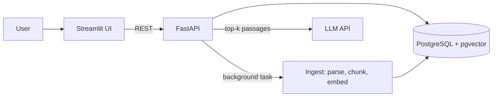

# DocuMind

A **RAG (retrieval-augmented generation) document assistant** built with **FastAPI**.
Upload PDF/TXT files, then ask questions and get answers that cite the **file and page** they came from.

> Live demo: _add your link here_ · Demo video: _add your link here_

## Features

- **RAG pipeline:** PDF/TXT parsing → chunking → multilingual embeddings → pgvector similarity search → LLM answer with sources.
- **Honest answers:** if nothing relevant is found, the assistant says so instead of guessing.
- **Background processing:** uploads return immediately (`202`); parsing and embedding run in the background with a visible status (`pending → processing → ready / failed`).
- **Quality:** automated tests, CI on every pull request, Alembic migrations, request logging.
- **Evaluation:** a script measures how often the correct file and page appear in the retrieved sources.

## Architecture



**Upload flow:** file → validate type/size → store under a random name → `documents` row (`pending`) → background task parses, splits (≈800 characters, 150 overlap), embeds (384 dimensions) and saves `chunks` → `ready`.

**Question flow:** embed the question → cosine search over the chunks of ready documents → drop results below the similarity threshold → send the remaining passages and the question to the LLM with an "answer only from these passages" instruction → return the answer and its sources.

## Tech stack

Python 3.12 · FastAPI · SQLAlchemy 2 · Alembic · PostgreSQL 16 + pgvector · fastembed (`paraphrase-multilingual-MiniLM-L12-v2`) · pypdf · Anthropic API · Streamlit · pytest · ruff · Docker · GitHub Actions · GitHub Codespaces

## Quick start (GitHub Codespaces)

1. Open the repository on GitHub → **Code → Codespaces → Create codespace on main**. Dependencies install automatically.
2. Create your settings file and (optionally) add an LLM key:
   ```bash
   cp .env.example .env
   ```
   Without `LLM_API_KEY` the app uses a fake LLM, so everything except real answers still works. Store a real key as a Codespaces secret, never in git.
3. Start the database and apply migrations:
   ```bash
   docker compose up -d db
   cd backend && alembic upgrade head
   ```
4. Run the API (terminal 1) and the UI (terminal 2):
   ```bash
   cd backend && uvicorn app.main:app --reload --port 8000
   cd frontend && streamlit run app.py --server.port 8501
   ```
5. Open the forwarded port 8501, upload a PDF and ask a question. The interactive API docs are at `/docs` on port 8000.

The first embedding run downloads the model (a few hundred MB, once).

## API

| Method | Path | Description |
| --- | --- | --- |
| GET | `/health` | Health check |
| POST | `/documents` | Upload a PDF/TXT file (`202`, processed in the background) |
| GET | `/documents` | List documents with their status |
| DELETE | `/documents/{id}` | Delete a document and its chunks |
| POST | `/chat` | `{"question": "..."}` → `{"answer": "...", "sources": [{filename, page, snippet}]}` |

## Tests

```bash
docker compose up -d db
cd backend
EMBEDDING_BACKEND=fake SIMILARITY_THRESHOLD=0.05 pytest --cov=app
```

Tests use a fast deterministic fake embedding and a fake LLM, so they need only the database. They cover chunking, upload validation, the full upload → ask → sources flow, the "not found" behaviour, deletion and failed processing.

## Evaluation

1. Upload your test documents.
2. Copy `eval/questions.example.csv` to `eval/questions.csv` and write 15–20 questions with the expected file and page.
3. Run `python eval/run_eval.py`.

| Chunk size | Similarity threshold | Correct source in top 6 |
| --- | --- | --- |
| 800 | 0.25 | _fill in_ |

## Design decisions

- **Sync SQLAlchemy and `BackgroundTasks`:** simpler and enough for this scale. A real job queue (Redis + ARQ) is a later step.
- **Own database session in the background task:** the request session is closed once the response is sent.
- **Fake embeddings and fake LLM in tests:** fast, free and deterministic.
- **Random file names on disk:** the client's file name is never used as a path.
- **Relevance threshold:** weak matches are dropped, so the assistant answers "not found" instead of inventing.

## Limitations

- Scanned PDFs (images) are not supported; there is no OCR.
- Uploaded files live on local disk.
- There is no user login: anyone who can reach the API can use it.

## Future work

- Streaming answers (show the answer word by word).
- OCR for scanned PDFs and support for more file types (DOCX).
- Rate limiting, a Redis job queue and object storage for uploaded files.
- Deployment to a public URL.

## Project structure

```
backend/app/   main.py, config.py, db.py, models.py, schemas.py
               routers/ (documents, chat)
               ai/ (parsers, chunking, embeddings, llm)
               services/ (ingest, rag)
backend/alembic/   database migrations
backend/tests/     pytest suite
frontend/          Streamlit app
eval/              retrieval evaluation
```

## Team

Ibrahim Mohamed Omar, Melike Çeliktaş, Muhtad Haseeb Mustapha

Course: Advanced Computer Programming
