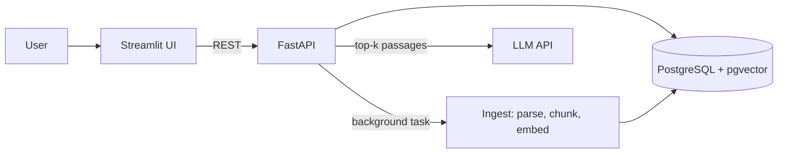
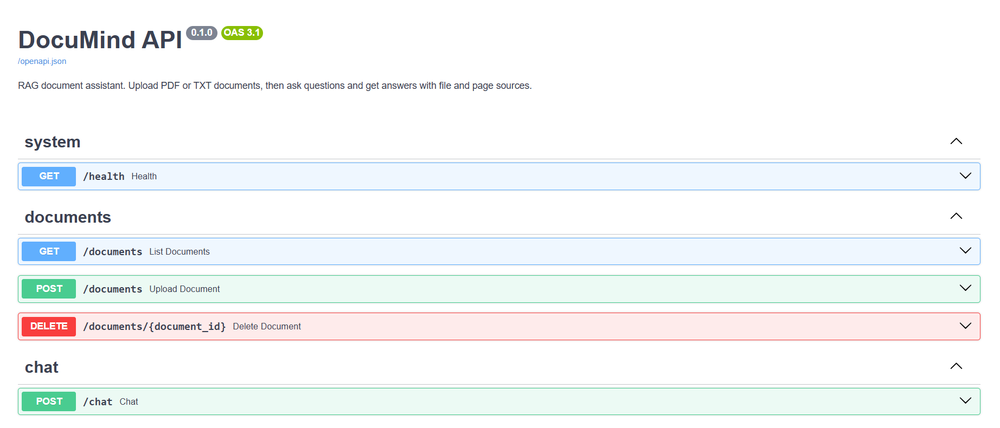

# DocuMind

A **RAG (retrieval-augmented generation) document assistant** built with **FastAPI**.
Upload PDF/TXT files, then ask questions and get answers that cite the **file and page** they came from.

> Live demo: _add your link here_ · Demo video: _add your link here_

## Features

- **RAG pipeline:** PDF/TXT parsing → chunking → multilingual embeddings → pgvector similarity search → LLM answer with sources.
- **Honest answers:** if nothing relevant is found, the assistant says so instead of guessing.
- **Background processing:** uploads return immediately (`202`); parsing and embedding run in the background with a visible status (`pending → processing → ready / failed`).
- **Quality:** automated tests, CI on every pull request, Alembic migrations, request logging.
- **Evaluation:** a script measures how often the correct file and page appear in the retrieved sources.

## Architecture



**Upload flow:** file → validate type/size → store under a random name → `documents` row (`pending`) → background task parses, splits (≈800 characters, 150 overlap), embeds (384 dimensions) and saves `chunks` → `ready`.

**Question flow:** embed the question → cosine search over the chunks of ready documents → drop results below the similarity threshold → send the remaining passages and the question to the LLM with an "answer only from these passages" instruction → return the answer and its sources.

## Tech stack

Python 3.12 · FastAPI · SQLAlchemy 2 · Alembic · PostgreSQL 16 + pgvector · fastembed (`paraphrase-multilingual-MiniLM-L12-v2`) · pypdf · Anthropic or OpenRouter API · Streamlit · pytest · ruff · Docker · GitHub Actions · GitHub Codespaces

## Quick start (GitHub Codespaces)

1. Open the repository on GitHub → **Code → Codespaces → Create codespace on main**. Dependencies install automatically.
2. Create your settings file and (optionally) add an LLM key:
   ```bash
   cp .env.example .env
   ```
   Without `LLM_API_KEY` the app uses a fake LLM, so everything except real answers still works. Store a real key as a Codespaces secret, never in git.
3. Start the database and apply migrations:
   ```bash
   docker compose up -d db
   cd backend && alembic upgrade head
   ```
4. Run the API and the UI, each in its own terminal (see "Running the project" below):
   ```bash
   cd backend && uvicorn app.main:app --reload --port 8000
   cd frontend && streamlit run app.py --server.port 8501
   ```
5. Open the forwarded port 8501, upload a PDF and ask a question. The interactive API docs are at `/docs` on port 8000.

The first embedding run downloads the model (a few hundred MB, once).

## Running the project (every time you open or restart a Codespace)

After a Codespace restart the database container is stopped. If you skip this step,
the API answers with HTTP 500 and the UI shows "Cannot reach the API" when the
backend is not running.

You need **three terminals**. The database, the backend and the frontend must all
run at the same time, each in its own terminal.

**Terminal 1: database** (project root)

```bash
docker compose up -d db
docker compose ps        # wait until the db row says "healthy"
```

Only on a fresh database (first time, or after the volume was deleted):

```bash
cd backend && alembic upgrade head
```

**Terminal 2: backend**

```bash
cd backend
uvicorn app.main:app --reload --port 8000
```

**Terminal 3: frontend**

```bash
cd frontend
streamlit run app.py --server.port 8501
```

Open port 8501 from the **Ports** tab for the app, and `/docs` on port 8000 for the
interactive API documentation.

### LLM secrets

Real answers need three Codespaces secrets. Add them under
GitHub → Settings → Codespaces → Secrets (repository: DocuMind):

| Secret | Meaning |
| --- | --- |
| `LLM_API_KEY` | Your API key |
| `LLM_PROVIDER` | `openrouter` |
| `LLM_MODEL` | Model name, for example `openai/gpt-4o-mini` for OpenRouter |

Restart the Codespace after adding or changing secrets. Without `LLM_API_KEY` the
app uses a fake LLM that returns a placeholder answer. Never write keys into files
or commits.

## API

| Method | Path | Description |
| --- | --- | --- |
| GET | `/health` | Health check |
| POST | `/documents` | Upload a PDF/TXT file (`202`, processed in the background). Returns `409` if a document with the same name exists |
| GET | `/documents` | List documents with their status |
| DELETE | `/documents/{id}` | Delete a document and its chunks |
| POST | `/chat` | `{"question": "..."}` → `{"answer": "...", "sources": [{filename, page, snippet}]}` |



### Example requests

```bash
# Upload a document (returns 202 and status "pending")
curl -F "file=@sample.pdf" http://localhost:8000/documents

# List documents and their status (wait for "ready")
curl http://localhost:8000/documents

# Ask a question
curl -X POST http://localhost:8000/chat \
  -H "Content-Type: application/json" \
  -d '{"question": "What is the line count of the open-source GIS package?"}'

# Delete a document
curl -X DELETE http://localhost:8000/documents/1
```

Uploading a second file with the same name returns `409`. Delete the old one first.

## Tests

```bash
docker compose up -d db
cd backend
EMBEDDING_BACKEND=fake SIMILARITY_THRESHOLD=0.05 pytest --cov=app
```

Tests use a fast deterministic fake embedding and a fake LLM, so they need only the database. They cover chunking, upload validation, the full upload → ask → sources flow, the "not found" behaviour, deletion and failed processing.

## Evaluation

A sample document and question set are included:

- `eval/regulation.pdf`: a 14-page fictional university regulation (internship, exams, attendance, graduation).
- `eval/questions.csv`: 20 direct questions about it, each with the file and page where the answer is.
- `eval/questions_paraphrased.csv`: 12 paraphrased questions (different wording than the document) for the same pages.

1. Start the API with the real embedding model (`EMBEDDING_BACKEND=fastembed`, the default in `.env.example`).
2. Upload `eval/regulation.pdf` (keep the file name `regulation.pdf`) and wait until its status is `ready`.
3. Run `python eval/run_eval.py --questions eval/questions.csv` (and the same with `eval/questions_paraphrased.csv`).

The evaluation only checks the retrieved sources, so the LLM is not needed (an empty `LLM_API_KEY` uses the fake LLM).
Chunk size is set with `CHUNK_SIZE` and `CHUNK_OVERLAP` (default 800 and 150 characters). It is applied when a document is processed, so re-upload documents after changing it.

To evaluate your own documents, copy `eval/questions.example.csv` and write 15–20 questions with the expected file and page.

Results for `regulation.pdf` with similarity threshold 0.25 and overlap 150:

| Chunk size | Chunks | Top-1 | Top-3 | Top-6 | Paraphrased Top-1 | Paraphrased Top-3 | Paraphrased Top-6 |
| --- | --- | --- | --- | --- | --- | --- | --- |
| 500 | 58 | 14/20 (70%) | 19/20 (95%) | 20/20 (100%) | 5/12 (42%) | 11/12 (92%) | 12/12 (100%) |
| **800 (default)** | 30 | 13/20 (65%) | 19/20 (95%) | 20/20 (100%) | 8/12 (67%) | 9/12 (75%) | 12/12 (100%) |
| 1200 | 22 | 13/20 (65%) | 18/20 (90%) | 19/20 (95%) | 6/12 (50%) | 8/12 (67%) | 11/12 (92%) |

Top-k counts chunks, not distinct pages. The test PDF has only 14 pages, so top-6 is lenient and top-1 and top-3 are the stricter scores.

We keep 800 as the default. Smaller chunks (500) are more precise and win slightly on direct top-1, but each chunk has less context, and paraphrased top-1 drops from 67% to 42%. Bigger chunks (1200) give more context but fewer, coarser results, and score equal or worse on every measure.

## Design decisions

- **Sync SQLAlchemy and `BackgroundTasks`:** simpler and enough for this scale. A real job queue (Redis + ARQ) is a later step.
- **Own database session in the background task:** the request session is closed once the response is sent.
- **Fake embeddings and fake LLM in tests:** fast, free and deterministic.
- **Random file names on disk:** the client's file name is never used as a path.
- **Relevance threshold:** weak matches are dropped, so the assistant answers "not found" instead of inventing.

## Limitations

- Scanned PDFs (images) are not supported; there is no OCR.
- Uploaded files live on local disk.
- There is no user login: anyone who can reach the API can use it.

## Future work

- Streaming answers (show the answer word by word).
- OCR for scanned PDFs and support for more file types (DOCX).
- Rate limiting, a Redis job queue and object storage for uploaded files.
- Deployment to a public URL.

## Project structure

```
backend/app/   main.py, config.py, db.py, models.py, schemas.py
               routers/ (documents, chat)
               ai/ (parsers, chunking, embeddings, llm)
               services/ (ingest, rag)
backend/alembic/   database migrations
backend/tests/     pytest suite
frontend/          Streamlit app
eval/              retrieval evaluation
```

## Team

Ibrahim Mohamed Omar, Melike Çeliktaş, Muhtad Haseeb Mustapha

Course: Advanced Computer Programming
